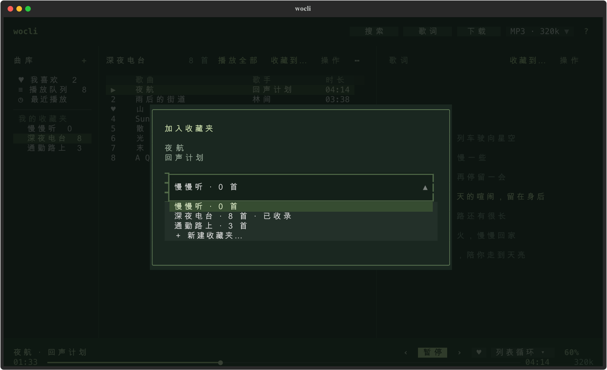

# wocli-music

在终端搜索、听歌、看歌词和整理收藏夹。无需登录，退出界面后音乐继续播放。

[下载 v0.1.0](https://github.com/yhan-sun/wocli-music/releases/tag/v0.1.0) · [安装](#安装) · [开始听歌](#开始听歌) · [使用方案](#使用方案) · [常见问题](#常见问题) · [更新日志](CHANGELOG.md)


## 能做什么

- **找歌与播放**：搜索歌名或歌手，点击选歌、Enter 播放；也支持本地音频。
- **整理音乐**：我喜欢、自建收藏夹、队列和最近播放；直接点击「收藏到…」选择收藏夹。
- **控制播放**：顺序、列表循环、单曲循环、随机播放；点击或拖动进度条跳转。
- **同步歌词**：显示当前行，支持独立刷新和本地同名 LRC。
- **后台听歌与下载**：退出界面后继续；可选择下载音质、目录和是否保存歌词。
- **命令行控制**：搜索、播放、收藏夹和播放状态均可用 CLI 操作，支持 JSON 输出。

当前支持 **macOS / Linux、Python 3.11+、mpv**。音乐来自酷我音源；搜索结果中的部分歌曲或音质可能没有完整音频，程序会区分无音源、试听和网络错误。账号歌单同步、Windows 后台控制、系统媒体键和封面显示暂未实现。

## 安装

### 方案一：安装发行版

适合日常使用，安装后在任意目录运行 `wocli`，不需要克隆仓库。

先安装音频后端：

```bash
# macOS
brew install mpv

# Ubuntu / Debian
sudo apt install mpv
```

安装 [uv](https://docs.astral.sh/uv/getting-started/installation/) 后，安装应用：

```bash
uv tool install --python 3.12 "https://github.com/yhan-sun/wocli-music/releases/download/v0.1.0/wocli_music-0.1.0-py3-none-any.whl"
wocli --version
wocli doctor
wocli
```

uv 会创建独立环境，并在需要时下载指定的 Python；不会把应用依赖装进系统 Python。工具安装方式见 [uv 官方说明](https://docs.astral.sh/uv/guides/tools/)。如果提示找不到 `wocli`，运行 `uv tool update-shell`，然后重新打开终端。

也可以从 [Releases](https://github.com/yhan-sun/wocli-music/releases) 下载 wheel 后安装；已有 Python 3.11+ 和 pipx 的用户可以使用第二条命令：

```bash
uv tool install ./wocli_music-0.1.0-py3-none-any.whl
# 或
pipx install ./wocli_music-0.1.0-py3-none-any.whl
```

发行文件说明：

| 文件 | 用途 |
| --- | --- |
| `wocli_music-0.1.0-py3-none-any.whl` | 应用安装包，支持上述 macOS / Linux 环境；仍需 Python 和 mpv |
| `wocli_music-0.1.0.tar.gz` | 源码发行包，用于源码安装或二次开发 |
| `SHA256SUMS` | 两个发行包的 SHA-256 校验值 |

下载三个文件到同一目录后，可执行 `shasum -a 256 -c SHA256SUMS`（macOS）或 `sha256sum -c SHA256SUMS`（Linux）校验。

当前通过 GitHub Releases 分发，尚未发布到 PyPI；安装时请使用上面的链接或本地文件路径。

### 方案二：从源码运行

适合修改代码、跟随开发版本的用户。先安装 uv 和 mpv，然后执行：

```bash
git clone https://github.com/yhan-sun/wocli-music.git
cd wocli-music
uv sync --locked
uv run wocli
```

源码目录中的命令需要加 `uv run`，例如 `uv run wocli stop`。想把源码版本安装为全局命令，可在该目录运行 `uv tool install .`。

### 更新与卸载

更新源码版本：

```bash
# 先退出界面、停止旧后台，避免继续运行旧代码
uv run wocli daemon stop
git pull --ff-only
uv sync --locked
uv run wocli
```

更新全局安装的版本时，先退出界面并运行 `wocli daemon stop`，再用 `uv tool install --force <新版 wheel 路径或链接>` 安装。新版本下载见 [Releases](https://github.com/yhan-sun/wocli-music/releases)。

卸载应用：

```bash
wocli daemon stop
uv tool uninstall wocli-music
# 使用 pipx 安装时改为：pipx uninstall wocli-music
```

收藏夹、配置和已下载歌曲会保留。数据位置见[配置与数据](#配置与数据)。

## 开始听歌

1. 运行 `wocli`，点击顶部「搜索」或按 `/`，输入歌名 / 歌手后回车。
2. 上下键或单击选中歌曲，按 Enter 或双击开始播放。空格暂停 / 继续，底部进度条可点击和拖动。
3. 点击列表顶部「收藏到…」，选择已有收藏夹，或在下拉菜单选择「＋ 新建收藏夹…」。
4. 点击底部播放方式，选择顺序、列表循环、单曲循环或随机；点音量百分比调整音量。
5. 按 `q` 退出界面，音乐继续播放。停止音乐运行 `wocli stop`，彻底退出后台运行 `wocli daemon stop`。

「我喜欢」是爱心收藏；自建收藏夹用于分类，同一首歌可以加入多个收藏夹。列表顶部的操作作用于**选中的歌**；歌词面板顶部和底部爱心作用于**当前播放的歌**。

### 界面与截图

左侧切换曲库和收藏夹，中间是当前列表，右侧是同步歌词，底部显示歌曲、播放控制和时间进度。搜索栏平时收起，Esc 收起搜索并返回之前的曲库。

**收藏到指定收藏夹**



**窄终端布局**


不足 120 列时收起右侧歌词，不足 68 列时通过顶部「曲库」菜单切换收藏夹。按 `v` 或点顶部「歌词」展开当前播放与歌词，Esc 返回。

以上为真实 Textual 界面的截图，使用虚构的演示曲库与原创演示歌词；不代表这些歌曲可被在线搜索。生成截图不访问音源，也不播放音频。

## 使用方案

### 工作时在后台听歌

在界面里选好收藏夹，点击「播放全部」，选择列表循环或随机播放后按 `q`。后续可以从其他终端控制：

```bash
wocli pause
wocli resume
wocli next
wocli prev
wocli volume 45
wocli status
wocli                       # 重新打开界面，查看当前播放
```

关闭界面不会停止后台；系统退出或重启会终止播放。再次启动服务会保留队列，但不会自行出声。

### 整理通勤、工作和夜间收藏夹

在界面按 `n` 或点击侧栏「+」新建收藏夹。在搜索结果里选歌，点击「收藏到…」或按 `c` 加入；下次会记住上次使用的收藏夹。收藏夹标题旁「⋯」可重命名或删除，Delete 只将选中的歌移出当前列表。

也可以用 CLI 管理：

```bash
wocli search "周杰伦 晴天"          # 从结果中查看歌曲 ID
wocli playlist create "通勤"
wocli playlist add "通勤" --id kuwo:228908
wocli playlist list
wocli playlist show "通勤"
wocli playlist play "通勤"
wocli mode shuffle
wocli playlist rename "通勤" "路上听"
```

示例 ID 用于展示参数格式，实际可用性以音源返回为准。删除收藏夹仅删除该夹及收录关系，其他收藏夹、我喜欢和本地音频文件会保留。

### 下载音频和歌词，再播放本地文件

在列表选歌后按 `d`，或从「操作 → 下载」进入下载窗口；选择音质、目录及是否保存 LRC。顶部「下载」查看进度、文件位置，可取消或重试。歌词展开页的 `d` 下载当前播放歌曲。

界面提交的下载由后台执行，退出界面后继续。CLI 下载则在当前命令内执行，等待命令结束后文件才保存完成：

```bash
wocli download --id kuwo:228908 --quality best --lyrics --output ~/Music/wocli-music
wocli play "/实际保存目录/歌手 - 歌曲.mp3"
```

播放本地文件会读取同目录、同文件名的 `.lrc`，例如 `夜航.flac` 搭配 `夜航.lrc`。本地文件无需在线解析音源；文件需要留在原路径，收藏夹记录不会复制音频。

界面下载文件名包含 ID 和实际音质；CLI 文件名为「歌手 - 歌名」。已有文件默认保留；CLI 可显式用 `--force` 覆盖。后台最多保留 10 项未完成下载，重启后台不保留任务记录，已完成的文件仍在。下载需要上游提供完整音频，无法取得完整版的歌曲不会被保存成试听文件。

### 在脚本中查询和控制

```bash
wocli search "周杰伦 晴天" --limit 5 --json
wocli play "周杰伦 晴天" --pick 1 --json
wocli status --json
wocli queue add --id kuwo:228908 --next
wocli queue list --json
```

搜索多条结果时，非交互环境需要用 `--pick N` 明确选歌，或直接指定 `--id`。`--pick` 从 1 开始，搜索排序由上游决定，需要固定歌曲时使用 ID。`play` 会替换当前队列；连续添加歌曲使用 `queue add`。JSON 错误写入 stderr，并返回非零退出码；TUI 需要真实终端。

## 常用快捷键

输入搜索内容时，字母会正常输入；快捷键不会覆盖输入框。随时按 `?` 查看帮助。

| 操作 | 快捷键 |
| --- | --- |
| 搜索 / 返回列表 | `/`、`Ctrl+F` / `Esc` |
| 播放选中歌曲 / 暂停或继续当前歌曲 | `Enter` / `Space` |
| 收藏到指定收藏夹 / 喜欢选中歌曲 | `c` / `f` |
| 歌曲操作 / 加入队列 / 下载 | `x` / `a` / `d` |
| 新建收藏夹 / 重命名 / 移出歌曲 | `n` / `r` / `Delete` |
| 播放方式 / 音乐库 | `m` / `b` |
| 展开歌词 / 刷新歌词 | `v` / `l` |
| 重试当前音源 | `Ctrl+R` |
| 上一首 / 下一首 | `Ctrl+←` / `Ctrl+→` |
| 后退 / 前进 5 秒 | `←` / `→` |
| 音量增减 | `+` / `-` |
| 退出界面，保留后台播放 | `q`、`Ctrl+Q`、`Ctrl+C` |

展开歌词后，`c`、`f`、`d` 操作当前歌曲。播放方式弹窗内用数字 `1–4` 分别选择顺序、列表循环、单曲循环和随机；随机模式每轮不重复，上一首返回实际播放历史，单曲循环时也可手动切歌。

## 命令行速查

```bash
wocli --help
wocli play --help
wocli play "周杰伦 晴天"                 # 交互选择
wocli play --id kuwo:228908 --quality best
wocli play                              # 从保留队列的所选歌曲重新开始
wocli seek +10
wocli seek -10
wocli mode repeat                       # list / repeat / single / shuffle
wocli like                              # 切换当前歌曲的爱心收藏
wocli favorites
wocli history
wocli queue remove 2
wocli queue clear                       # 清空队列并停止播放
wocli playlist remove "通勤" --id kuwo:228908
wocli playlist delete "通勤"
wocli lyrics --id kuwo:228908 --refresh
wocli lyrics --output song.lrc           # 导出当前歌词，覆盖已有文件需 --force
wocli config
wocli config quality best
wocli config lyric_offset 200            # 正数让歌词提前，单位毫秒
wocli doctor
wocli daemon status
wocli daemon stop
```

`wocli-music` 是 `wocli` 的等效命令名。

## 常见问题

### 能搜到歌，为什么无法播放？

搜索、歌词和音频来自不同请求。能搜到歌曲、能显示歌词，不代表音源提供该版本的完整音频。

| 状态 | 含义与处理 |
| --- | --- |
| 仅试听 | 上游返回试听或明显不完整的音频，程序拒绝播放；可试「换音质」，各档位均不可用时选择其他结果 |
| 无音源 | 已尝试的档位没有提供播放地址；稍后再试或换歌 |
| 其他失败 | 悬停底部失败状态查看具体原因，再检查网络、代理或音频后端 |

按 `v` 展开歌词面板，可点「重试音源」「换音质」「跳过」。重试作用于当前歌曲，保留队列；临时网络错误最多自动重试一次，每次解析限时 45 秒，明确无地址或只有试听时不会反复请求。

`wocli status --json` 的 `error_code` 和 `error_details` 提供错误分类、各档位的解析结果。换音质不能保证取得完整版，程序也不会自动换成另一位歌手或另一个版本。

### 歌词没有显示，或一直加载？

按 `l`，或从歌词面板「操作 → 刷新歌词」重新获取，不会中断音频。歌词请求限时 22 秒，失败保留已有有效歌词；本地歌曲检查同名 `.lrc` 是否存在。

在线歌词先按歌曲 ID 获取酷我时间轴，再尝试其他歌词来源，并检查歌名、歌手和时长。无法匹配时会提示缺失，不保证所有歌曲都有歌词。CLI 可用 `wocli lyrics --id <歌曲ID> --refresh` 刷新本地缓存，界面会自动读取。

### 提示没有 mpv，或没有声音？

先运行 `wocli doctor`，检查 `mpv` 路径。支持 PATH 中的 mpv，以及 `/Applications/mpv.app`、`~/Applications/mpv.app` 和数据目录下的 `tools/mpv.app`。使用自定义路径时，在启动应用和后台前设置 `WOCLI_MPV=/完整路径/mpv`。

若状态已经是播放中，检查系统输出设备、底部音量和 mpv 日志。`WOCLI_AUDIO_OUTPUT=null` 仅用于无声测试；日常使用应取消该环境变量。

### 搜索或解析请求超时？

默认尊重系统代理并校验 HTTPS 证书。明确需要直连时，可用 `wocli search "歌名" --direct` 临时测试，或执行 `wocli config direct true` 设置后台。恢复代理使用 `wocli config direct false`。请结合具体错误判断，不要因为单首歌不可用就反复更改网络设置。

### 退出后还在播放，怎样停止？

`q` 只关闭界面，`wocli stop` 停止音乐，`wocli daemon stop` 停止后台及其启动的 mpv，同时取消未完成的后台下载。

### 找不到收藏夹入口？

「收藏到…」位于列表顶部，也可按 `c`；歌词面板顶部有独立的当前歌曲入口。左侧曲库显示收藏夹；窄终端用顶部「曲库」或按 `b` 切换。底部爱心加入的是「我喜欢」，不会选择自建收藏夹。

## 配置与数据

默认目录为 `$XDG_CONFIG_HOME/wocli-music`，未设置时为 `~/.config/wocli-music`。`wocli doctor` 可查看实际目录；设置 `WOCLI_HOME` 可以使用另一份独立曲库和后台。

| 文件 | 内容 |
| --- | --- |
| `settings.json` | 音质、音量、播放方式、歌词偏移和代理设置 |
| `library.sqlite3` | 收藏夹、歌曲元数据、历史、保留队列和歌词缓存 |
| `service.log` | 后台服务日志 |
| `mpv.log` | 音频后端日志 |

备份前先退出界面并停止后台，再复制配置目录；恢复时使用同样方式关闭程序后还原。下载音频位于选择的保存目录，需单独备份。默认界面下载目录为 `~/Music/wocli-music`，CLI 默认下载目录为当前目录下的 `downloads`。

默认音质偏好 `320k`，不可用时尝试 `128k`；`flac` 和 `best` 会从无损开始尝试支持的档位。播放界面显示实际音质。音源链接在播放前解析，不存入收藏夹；程序检查音频头及长度，下载时校验总长度，以及服务器提供的 MD5。

## 开发与构建

```bash
uv sync --locked --group dev
uv run pytest
uv run ruff check .
uv run ruff format --check .
uv run python scripts/build_release.py
```

构建输出在 `dist/`：wheel、源码包和 `SHA256SUMS`。构建脚本检查项目元数据与代码中的版本号一致。依赖已缓存时，可加 `--offline`；发行包不包含 mpv，也不打包用户数据。

重新生成文档截图：

```bash
uv run --with resvg-py python scripts/screenshots.py --format both
```

默认写入 `docs/screenshots/`，生成主界面、收藏夹选择和窄屏布局的 PNG / SVG；只需要 SVG 时可省略额外依赖，运行 `uv run python scripts/screenshots.py`。截图使用临时数据目录，离线运行，不连接现有后台。

`uv run python scripts/preview.py` 则会查询真实搜索结果、导出 SVG，并使用当前数据目录；用于音源和搜索界面调试，不会主动播放。

测试覆盖协议解析、音频探测、下载校验、播放队列、异步切歌、IPC 生命周期、CLI 和 Textual 无头交互。默认测试不依赖真实账号、不访问外部音源、不输出声音。

主要模块：`provider.py` 音源、`player.py` mpv IPC、`service.py` 后台、`store.py` 本地曲库、`cli.py` 命令行、`tui.py` 终端界面。

## 参考与致谢

- [MiaowCham/ncm-cli](https://github.com/MiaowCham/ncm-cli)：终端选歌、常驻播放器与歌词交互参考，许可文本见 [NOTICE.md](NOTICE.md)。本项目独立实现 Python 播放器和后台，没有引入其登录流程与远端 API 部署。
- 音源模块从最初的 `music/kw_full.py` 脚本提取与改写；运行和安装本项目不需要该脚本或相邻目录。
- [mpv](https://mpv.io/)、[Textual](https://textual.textualize.io/)、[Rich](https://rich.readthedocs.io/)：音频后端与终端界面基础。
