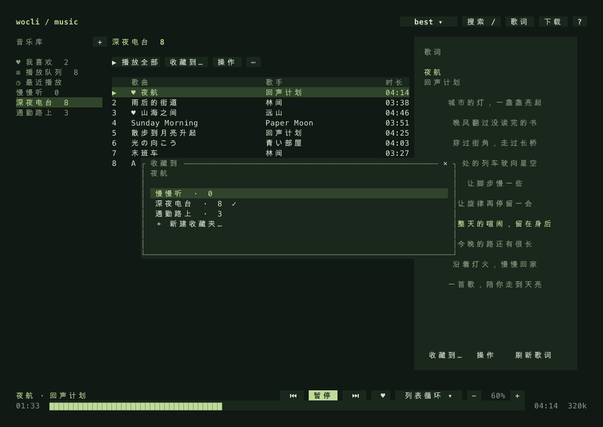

# wocli-music

在终端搜索、听歌、看歌词和整理收藏夹。100% 纯 Rust 原生单二进制音乐播放器，毫秒级渐进流式播放，退出界面后音乐继续播放。

[English Documentation](README_EN.md) · [下载发行版](https://github.com/yhan-sun/wocli-music/releases/latest) · [一键安装](#安装) · [使用方案](#使用方案) · [命令行](#命令行) · [快捷键](#快捷键) · [环境变量与配置](#环境变量与配置) · [常见问题](#常见问题) · [更新日志](CHANGELOG.md)


## 能做什么

- **毫秒级渐进流式播放（Progressive Streaming）**：Symphonia 解码器仅需读取前 16KB 元数据立即起播，首播/切歌延迟 < 200ms，边下边播后台无感缓冲。
- **键盘优先与 Vim 导航**：支持 `j`/`k` 移动、`g`/`G` 置顶置底、`[`/`]` 切歌、`Ctrl+U`/`Ctrl+D` 翻页。
- **高稳定性常驻后台**：内置有界工作线程池（`WorkerPool`）与 CAS 客户端并发限流，守护进程零窗口静默运行，退出 TUI 音乐继续。
- **本地与在线统一管理**：搜索公开音源，支持本地 MP3、FLAC、AAC/M4A、WAV；自建收藏夹、我喜欢、播放队列、最近播放。
- **同步歌词与状态栏小图标**：动态解析逐句 LRC，支持 macOS 原生状态栏小图标与自适应桌面透明歌词条。
- **CLI 自动化与脚本控制**：每个控制均有独立 CLI 与 `--json` 输出，无缝融入终端工作流。
- **100% 纯 Rust 实现**：零 Python、零 mpv、零 FFmpeg 外部依赖，体积仅约 2.2 MB（macOS ARM64 压缩包）。

音乐来自公开音源，搜索不需要登录；部分曲目或音质可能无完整音频。程序会拒绝明显的试听片段、错误内容和不完整传输，并显示具体错误。没有账号歌单同步、封面或系统媒体键。

## 安装

无需预装 Rust、Python、uv、mpv 或 FFmpeg。

### 一键脚本安装（推荐）

#### macOS / Linux (Terminal)

在终端运行以下命令，脚本会自动识别你的系统（macOS ARM64 / Intel、Linux x86_64）、下载对应安装包、校验 SHA256 完整性并安装到用户命令路径：

```bash
curl -fsSL https://raw.githubusercontent.com/yhan-sun/wocli-music/main/install.sh | bash
```

- **自定义安装目录**（例如安装到 `/usr/local/bin`）：
  ```bash
  curl -fsSL https://raw.githubusercontent.com/yhan-sun/wocli-music/main/install.sh | bash -s -- --dir /usr/local/bin
  ```
- **指定安装版本**：
  ```bash
  curl -fsSL https://raw.githubusercontent.com/yhan-sun/wocli-music/main/install.sh | bash -s -- --version v0.2.0
  ```
- **卸载**：
  ```bash
  curl -fsSL https://raw.githubusercontent.com/yhan-sun/wocli-music/main/install.sh | bash -s -- --uninstall
  ```

#### Windows (PowerShell)

在 PowerShell 中执行以下命令，脚本会自动下载 Windows 原生版本、校验 SHA256 签名，并配置用户及当前 PowerShell 的 PATH，安装后可直接运行 `wocli`：

```powershell
irm https://raw.githubusercontent.com/yhan-sun/wocli-music/main/install.ps1 | iex
```

安装完成后，当前 PowerShell 无需重开。其他已经打开的终端需要完全退出并重新启动终端应用，才能继承更新后的 PATH。若旧安装仍提示找不到命令，可先在 PowerShell 执行：

```powershell
$env:Path += ";$env:LOCALAPPDATA\Programs\wocli-music"
wocli --version
```

使用自定义安装目录时，将上面的目录替换为实际目录。

- **自定义安装目录**：
  ```powershell
  & ([scriptblock]::Create((irm https://raw.githubusercontent.com/yhan-sun/wocli-music/main/install.ps1))) -InstallDir "C:\Tools\wocli"
  ```
- **卸载**：
  ```powershell
  & ([scriptblock]::Create((irm https://raw.githubusercontent.com/yhan-sun/wocli-music/main/install.ps1))) -Uninstall
  ```

### 更新

从 v0.3.1 起，可直接执行：

```bash
wocli update --check     # 只检查最新稳定版
wocli update             # 下载、校验 SHA256 并更新当前安装
wocli update --force     # 重新安装当前稳定版
```

支持 `--json` 和 `--direct`。更新保留曲库、收藏、队列与设置；正在运行的后台和托盘会停止并重新启动，播放需要重新开始。安装目录需要当前账户有写权限。通过 Linux 安装脚本创建的入口包装脚本会保留，更新实际程序及配套 ALSA 库。

v0.3.0 及更早版本尚无 `update` 命令，首次升级请重新执行上面的安装命令。Windows 安装脚本还会修复当前 PowerShell 的 PATH。

### 手动下载安装

你也可以直接从 [Releases](https://github.com/yhan-sun/wocli-music/releases/latest) 下载对应平台的打包文件：

| 设备与架构 | 发行文件 | 解包安装方式 |
| --- | --- | --- |
| Apple Silicon Mac (macOS 15+) | `wocli-music-0.2.0-macos-arm64.tar.gz` | 解压后将 `wocli` 复制到 `~/.local/bin/` |
| Intel Mac (macOS 15+) | `wocli-music-0.2.0-macos-x86_64.tar.gz` | 解压后将 `wocli` 复制到 `~/.local/bin/` |
| Linux x86_64 (glibc 2.35+) | `wocli-music-0.2.0-linux-x86_64.tar.gz` | 解压后保留 `lib/` 在 `wocli` 同级目录下 |
| Windows 10/11 x86_64 / ARM64 | `wocli-music-0.2.0-windows-x86_64.zip` | 解压后将 `wocli.exe` 放置于任何 PATH 目录 |

以 Apple Silicon Mac 为例：

```bash
tar -xzf wocli-music-0.2.0-macos-arm64.tar.gz
cd wocli-music-0.2.0-macos-arm64
./wocli
```

> **说明**：
> - Linux 版本保留自带的 ALSA 音频库 `lib/libasound.so.2` 位于 `wocli` 旁边；直接运行即可使用系统桌面的声音配置。
> - `*-sources.tar.gz` 是第三方依赖许可要求的源码包，**用户日常使用无需下载**。每个安装包内均包含 `THIRD_PARTY.txt` 与对应许可证。
> - macOS 发行版如提示安全阻止，可对解压文件执行 `xattr -d com.apple.quarantine ./wocli` 移除隔离属性。

### 从旧版升级

先退出旧界面，使用旧版命令彻底停止后台常驻进程，再启动新二进制：

```bash
# 原来从 Python 源码运行：
uv run wocli daemon stop
# 或在旧版二进制目录下：
./wocli daemon stop

# 启动新版本
wocli
```

旧版的 `library.sqlite3` 曲库与 `settings.json` 会被无缝继承：自建收藏夹、我喜欢、历史播放、队列、歌词缓存均无需重新导入。改过 `WOCLI_HOME` 的用户在新版本中继续指定相同路径即可。

## 使用方案

### 找歌与听歌

启动 `wocli`，点击顶部「搜索」或按 `/`，输入关键词后 Enter。搜索只占列表顶部一行。方向键选择，Enter 播放；鼠标双击也能播放。播放后可关闭搜索继续浏览曲库。

底部只保留歌曲信息、播放控制和时间轴。Space 暂停或继续；点击时间轴定位，拖动松开后跳转。`m` 切换播放方式，`+` / `-` 调整音量。界面退出用 `q`，音乐继续；停止播放用 `wocli stop`，结束后台用 `wocli daemon stop`。

### 整理收藏夹

选中歌曲后点击 **「收藏到…」** 或按 `c`，从收藏夹列表选择，也可在此直接新建。`f` 加入或移出「我喜欢」。歌曲菜单 `x` 包含收藏、下一首播放、加入队列、下载与从当前列表移除。

侧栏 `+` 或 `n` 新建收藏夹；收藏夹标题旁 `⋯` 可重命名、删除。删除收藏夹只移除列表关系，保留其他收藏与本地文件。`b` 可打开音乐库选择菜单，窄窗口也能切换收藏夹。



### 看歌词、处理播放失败

宽窗口右侧显示歌词；`v` 切换完整歌词视图，Esc 返回。歌词失败时可以点「重试歌词」，或按 `l` 独立刷新，不需要中断音乐。本地音频读取同名 `.lrc`。

歌曲失败时显示原因，可「重试」或「切换音质」。Ctrl+R 手动重试当前歌曲；网络错误自动重试一次，单首最多两次尝试。歌词与歌曲分别加载，切歌后会丢弃上一首的过期结果。

在线播放采用渐进式流式播放：解析音源并预缓冲最多 256KB 后起播，其余音频在后台下载。起播速度取决于网络和音频格式。流式网络中断会重试一次，无法播放的歌曲自动跳过，整队列失败后停止并显示错误。下载与播放均校验传输完整性。

### 保存歌曲

选中歌曲后按 `d` 或从歌曲菜单选择「下载」，编辑目录、音质与「保存 LRC」，然后开始下载。顶部「下载」查看任务、进度和错误；失败任务可重试，进行中的任务可取消。下载在后台进行，退出界面后继续，退出后台会取消未完成任务。

默认不覆盖同名文件。传输使用分块、长度检查和上游提供的 MD5；校验失败清理临时文件，保留已有文件。

### 小窗口


小窗口收起右侧歌词，`v` 单独查看。宽度不足时侧栏隐藏，按 `b` 选择曲库。按 `?` 查看完整快捷键。

## 快捷键

| 按键 | 功能说明 |
| :--- | :--- |
| `j` / `k` 或 `↓` / `↑` | 上下选择歌曲 / 菜单项 |
| `g` / `G` 或 `Home` / `End` | 快速跳至列表顶部 / 底部 |
| `[` / `]` 或 `<` / `>` | 切换上一首 / 下一首 |
| `Space` | 播放 / 暂停切换 |
| `Enter` | 播放选中的歌曲 / 确定 |
| `/` 或 `Ctrl+F` | 聚焦搜索栏 |
| `←` / `→` | 快退 / 快进 5 秒 |
| `+` / `-` | 调整音量 |
| `Ctrl+U` / `Ctrl+D` | 向上 / 向下翻页 |
| `v` | 展开 / 收起全屏歌词 |
| `m` | 切换循环模式（顺序 / 列表循环 / 单曲 / 随机） |
| `c` | 收藏选中的歌曲到指定歌单 |
| `f` | 将歌曲加入 / 移出「我喜欢」 |
| `d` | 下载当前选中的歌曲 |
| `a` | 将歌曲添加到播放队列末尾 |
| `x` | 打开歌曲快捷操作菜单 |
| `Tab` | 侧栏曲库与主列表焦点切换 |
| `b` | 唤出曲库切换菜单 |
| `?` | 弹出快捷键帮助弹窗 |
| `Esc` | 退出歌词全屏 / 取消搜索 / 关闭弹窗 |
| `q` | 退出 TUI 界面（后台继续播放） |

## 命令行

```bash
wocli search '心做し majiko'
wocli play '心做し majiko' --pick 1
wocli play --id 61631119 --quality 320k
wocli play ~/Music/song.flac
wocli pause
wocli resume
wocli toggle               # 或 wocli play-pause
wocli next                 # 切下一首（支持别名 wocli skip，--no-wait 异步）
wocli prev                 # 切上一首（支持别名 wocli previous）
wocli seek +15
wocli volume 60
wocli mode shuffle          # list / repeat / single / shuffle
wocli status --json
wocli stop
```

### 任务栏小图标与实时任务栏歌词

```bash
wocli tray start           # 启动系统托盘小图标服务（macOS 菜单栏 / Windows 通知区）
wocli tray status          # 查看托盘运行状态
wocli tray stop            # 停止托盘服务

wocli lyrics-bar on        # 开启任务栏 / 状态栏实时歌词
wocli lyrics-bar off       # 关闭任务栏实时歌词
wocli lyrics-bar toggle    # 快速切换开启/关闭
```

- **macOS**：系统状态栏小图标直接实时呈现当前唱到的逐句歌词（`🎵 歌词内容`），点击展开原生控制菜单。
- **Windows**：桌面/任务栏置顶高对比度透明描边歌词条，支持鼠标直接穿透，托盘图标悬停展示多行完整歌词。

```bash
wocli like                 # 喜欢或取消喜欢当前歌曲
wocli favorites
wocli playlist create '通勤'
wocli playlist add '通勤' --id 61631119
wocli playlist show '通勤'
wocli playlist play '通勤'
wocli playlist rename '通勤' '每天听'
wocli queue add --id 61631119 --next
wocli lyrics --id 61631119 --refresh --output song.lrc
wocli download --id 61631119 --quality 320k --lyrics --output ~/Music/wocli
```

`--json` 用于脚本输出；非交互搜索播放请提供 `--pick` 或 `--id`，避免误选歌曲。`--no-wait` 让 `play` 在后台开始加载后立即返回。`download --force` 允许在下载成功并校验后覆盖目标。完整命令见 `wocli --help`。

```bash
wocli daemon status
wocli daemon stop
```

## 环境变量与配置

wocli-music 可以通过 CLI 命令设置持久化偏好，也可以使用环境变量在运行时灵活调整路径与网络行为。

### 环境变量

| 环境变量 | 默认值 | 说明 |
| :--- | :--- | :--- |
| `WOCLI_HOME` | `~/.config/wocli-music` (Linux/macOS)<br>`%APPDATA%\wocli-music` (Windows) | 数据与配置主目录。存放 SQLite 曲库 (`library.sqlite3`)、配置 (`settings.json`)、后台日志 (`service-rust.log`) 和歌词缓存。遵循 `XDG_CONFIG_HOME`。 |
| `WOCLI_RUNTIME_DIR` | `/tmp/wocli-rust-{uid}-{hash}` (Linux/macOS)<br>`%LOCALAPPDATA%\wocli-music\run` (Windows) | 运行期 IPC 控制 Socket/Endpoint 目录。类 Unix 下存放 `control.sock`，Windows 下存放 `control.endpoint`。 |
| `WOCLI_DOWNLOAD_DIR` | `~/Music/wocli` (TUI) / `downloads` (CLI) | 歌曲与歌词下载的默认目标保存目录。 |
| `WOCLI_AUDIO_OUTPUT` | *(默认系统声卡)* | 设为 `null` 时禁用实际音频硬件输出（仅解码不发声）。适用于无声卡服务器、容器环境或自动化测试。 |
| `HTTP_PROXY` / `HTTPS_PROXY` | *(无)* | HTTP / HTTPS 代理服务器地址（支持 socks5:// 或 http://），内部网络请求自动遵循代理设置。 |
| `ALL_PROXY` / `NO_PROXY` | *(无)* | 全局代理或跳过代理的主机名单。 |

使用示例：

```bash
# 使用独立的数据目录（多用户或多测试配置）
WOCLI_HOME=~/.config/wocli-work wocli

# 设定默认下载保存路径并直接启动
WOCLI_DOWNLOAD_DIR=~/Music/Favorites wocli

# 在无音频设备的远程服务器或容器中运行测试
WOCLI_AUDIO_OUTPUT=null wocli doctor
```

### 持久化配置

使用 `wocli config` 读写持久化设置（保存在 `$WOCLI_HOME/settings.json`）：

```bash
# 查看当前全部配置
wocli config

# 设置首选音质: best / 320k / 192k / 128k
wocli config quality best

# 设置默认循环模式: list (顺序) / repeat (列表循环) / single (单曲循环) / shuffle (随机)
wocli config mode repeat

# 设置启动音量 (0 - 100)
wocli config volume 70

# 设置歌词微调偏移 (毫秒，正数歌词提前，负数延后)
wocli config lyric_offset 200

# 忽略环境代理直接直连网络 (true / false)
wocli config direct true
```

### 环境诊断

运行 `wocli doctor` 可以快速排查当前环境、依赖、有效路径、活跃环境变量与运行状态：

```bash
wocli doctor
```

```json
{
  "architecture": "aarch64",
  "engine": "rodio/symphonia",
  "env": {
    "WOCLI_DOWNLOAD_DIR": "/Users/pyu/Downloads/Music"
  },
  "home": "/Users/pyu/.config/wocli-music",
  "platform": "macos",
  "runtime": "native",
  "runtime_dir": "/tmp/wocli-rust-501-bde92153d833",
  "service_running": false,
  "socket": "/tmp/wocli-rust-501-bde92153d833/control.sock",
  "version": "0.2.0"
}
```

## 常见问题

**为什么搜索到却播不了？** 搜索索引和音频授权并不一致。上游可能没有当前档位地址，只返回试听，或网络暂时失败。程序保持同一歌曲 ID 尝试其他音质，不用同名翻唱替换；失败信息区分无音源、仅试听、网络和解码错误。

**为什么没有声音？** 用 `wocli status` 检查状态和音量，确认系统输出设备。Linux 使用 ALSA 及桌面系统已有的声音配置；无声服务器没有可播放的硬件设备。`WOCLI_AUDIO_OUTPUT=null` 仅供测试，会解码但不输出声音。

**歌词不匹配或没找到？** 优先按歌曲 ID 获取，备用源会比较歌名、歌手和时长；Live/Remix 等版本不能随意混用。可独立刷新，或在本地音频旁放同名 LRC。

**如何备份？** 先停后台，复制整个数据目录。下载目录独立保存，按自己设置的位置备份。

## 开发与构建

需要 Rust **1.93.1+** 与 C 编译器。Linux 构建需 `libasound2-dev`、`pkg-config`；macOS 使用 Xcode Command Line Tools。

```bash
git clone https://github.com/yhan-sun/wocli-music.git
cd wocli-music
cargo run --release
cargo test --all-targets
cargo clippy --all-targets -- -D warnings
cargo build --release --locked
```

发布构建使用 `opt-level=z`、LTO、单 codegen unit、符号裁剪。GitHub Actions 为 macOS ARM64 / Intel、Linux x86_64 构建，验证解压后的实际产物，再发布 `v*` 标签；Linux 额外运行无 Python/mpv 的干净容器测试。Python 仅用于 CI 打包和截图，不是播放器运行依赖。

截图由真实 Rust TUI 的 TestBackend 渲染，使用隔离的虚构示例曲库：`uv run --with resvg-py python scripts/screenshots_native.py`。v0.3.0 已完全移除旧版 Python 实现，代码库为 100% 纯 Rust 实现。

项目交互参考 [MiaowCham/ncm-cli](https://github.com/MiaowCham/ncm-cli)，音源协议从原有 `../music` 脚本整理移植；不要求登录网易云账号。
