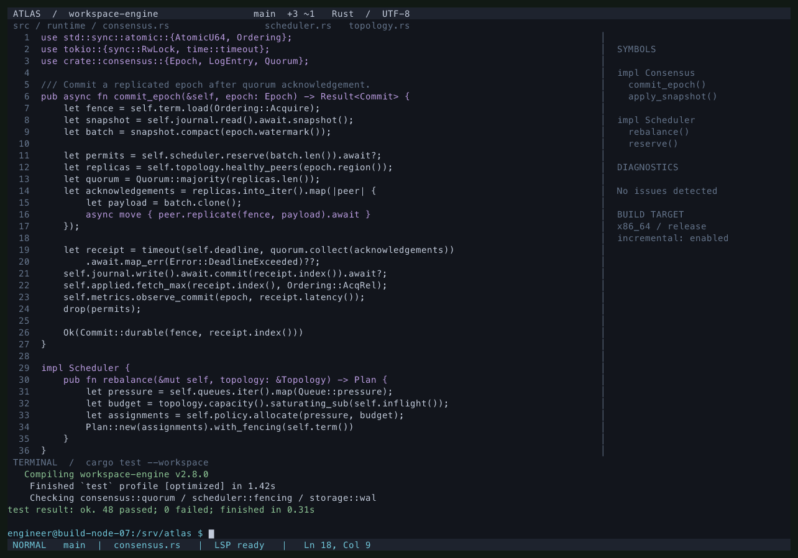

<div align="center">

  # wocli-music

  **Rediscover pure listening. Seamless music for your terminal and workflow.**
  <br />
  *Blazing-fast, zero-bloat, native music player for your terminal, scripts, and AI workflows.*

  <p align="center">
    <a href="https://github.com/yhan-sun/wocli-music/releases/latest"></a>
    
    
    
    <a href="docs/mcp.md"></a>
    <a href="LICENSE"></a>
  </p>

  <p align="center">
    <a href="#quick-start">Quick Start</a> •
    <a href="#why-build-it">Why Build It</a> •
    <a href="#comparison">Comparison</a> •
    <a href="#core-experience">Core Experience</a> •
    <a href="#quick-reference">Quick Reference</a> •
    <a href="README.md">中文文档</a>
  </p>

</div>

---

## Why Build It?

All we wanted was to listen to a song in peace, but modern music apps have lost their way:
- Downloading a 300MB installer just to play a track, forced to wait through splash screen ads on launch.
- Searching for a song only to hit "Scan QR code to log in" or "Subscribe to VIP for full track" paywalls.
- Interfaces cluttered with live streams, short videos, and banners, silently gobbling up hundreds of megabytes of RAM.
- Fumbling across desktop windows to switch tracks; when a manager walks by, giant album art glares from the screen.

`wocli-music` restores your listening freedom:

- **100% Login-Free**: No accounts, no QR codes, no ads. Type a track name and play immediately.
- **Native runtime**: Release bundles need no separately installed Rust, Python, Node, mpv or FFmpeg; Linux includes its ALSA library.
- **Authentic Boss Mode**: Instantly mutes audio and shows a fictional Rust engineering workspace.
- **Native Desktop Companion**: Close the terminal and music continues in the background; glance at lyrics in your macOS menu bar or Windows taskbar.
- **AI As Your Personal DJ**: Native MCP integration allows Claude or Cursor to curate, search, and manage playlists via natural language.

---

## Comparison

| Use case | wocli-music | Other tools and their focus |
| :--- | :--- | :--- |
| **Terminal, scripts and AI** | **TUI + CLI + native stdio MCP** share a daemon and SQLite library | go-musicfox focuses on NetEase in the terminal; ncmpcpp controls MPD |
| **Setup** | Runtime components ship in the bundle; no separate language runtime or external player required | ncmpcpp needs MPD; LX Music offers a desktop GUI and custom sources |
| **Work camouflage** | Fixed fictional engineering workspace, paused audio and hidden lyrics/track metadata | Refer to each project's documentation for similar features or extensions |
| **Playlist migration** | CSV/TXT, LX single-playlist v2, MusicFree and other files; rename, preserve unmatched entries and restore snapshots | Account synchronization and file migration are distinct capabilities |
| **Library and accounts** | No platform login; local favorites and Kuwo search metadata; availability depends on sources | Commercial clients provide their own account, subscription and offline features; wocli does not synchronize them |
| **Desktop lyrics** | macOS menu bar and Windows taskbar, with CLI/AI controlling the same daemon | GUI clients, system media protocols and MPD suit different workflows |

Size reference: the four official **v0.3.5** compressed runtime bundles were **3.01–4.21 MB**, including bundled files. These are historical release sizes, not memory or startup benchmarks. We have no controlled cross-player benchmark and do not claim fixed RAM usage, millisecond playback or unsupported competitor rankings. See [the comparison and primary sources](docs/comparison.md).

---

## Quick Start

```bash
# macOS / Linux
curl -fsSL https://wocli.yhan.fun/install.sh | bash

# Windows (PowerShell)
irm https://wocli.yhan.fun/install.ps1 | iex
```

### Listen in 30 Seconds

```bash
wocli                       # Launch interactive terminal player
wocli play 'Jay Chou Clear Day' # Search and play track directly from CLI
wocli toggle                  # Toggle play / pause
wocli mcp prompt             # Print AI prompt to connect with Claude / Cursor
```

> **Tip**: Press <kbd>q</kbd> in the terminal to exit the interface; **music and downloads continue seamlessly in the background**. Run `wocli stop` to pause playback, or `wocli daemon stop` to terminate the background daemon.

---

## Core Experience

### 1. Interactive Terminal UI & Floating Lyrics (TUI)
- Keyboard shortcuts (Vim keys `j`/`k`/`g`/`G`, `/` search) and full mouse support (seeking, clicking).
- Press <kbd>v</kbd> to enter full-screen synchronized lyrics.
- Manage local lossless audio and millions of online tracks in one place; press <kbd>d</kbd> for background downloading.

### 2. Boss Mode: Fictional Engineering Workspace

- Press `Shift+B`, `Ctrl+B` or `F12` to pause audio and show an ATLAS Rust workspace with line numbers, code, symbols, diagnostics and test logs.
- It uses a fixed fictional identity and **never reads real usernames, hostnames or personal paths**. Restore with b/B, Ctrl+B, F12 or Esc; playback resumes only if it was previously playing/loading.
- Start the tray with `wocli tray start` for global shortcuts: macOS `Ctrl+Shift+B`; Windows `Ctrl+Shift+B` / `Ctrl+Alt+B`. On Linux, bind `wocli boss` in desktop settings. Check registration with `wocli tray status`.
- Lyrics and track metadata are hidden; a neutral wocli tray entry remains. Uppercase B still types in input fields; F12 is available when tmux captures Ctrl+B.



### Playlist Migration

Import UTF-8 CSV/TSV/TXT, wocli v1 JSON, LX **single-playlist v2** `.lxmc`/JSON, MusicFree backups, M3U/M3U8/PLS and JSPF. Press `I` to import or `E` to export in the TUI. Select one playlist from multi-playlist backups, preview, then confirm.

```bash
wocli playlist import ./favorites.lxmc --name "Old favorites"
wocli playlist scan ./MusicFree.json
wocli playlist import ./MusicFree.json --list 1 --name "Phone favorites"
wocli playlist import ./commute.csv --dry-run --offline
wocli playlist export "Old favorites" --output ./favorites.wocli.json
```

Foreign IDs stay separate from playable Kuwo/local IDs. Unmatched entries and ambiguous candidates are retained. Use `inspect`, `resolve`, `match` and `drop` to repair entries. Name conflicts create another playlist by default; `--on-conflict rename|error|merge|replace` controls this. Merge/replacement and repair keep restorable snapshots (`backups` / `restore --id`). JSON preserves full metadata; CSV/TXT/JSPF exchange metadata, while M3U8 export requires local paths. Plugins in backups are never installed. Online playlist links, legacy/full LX backups, Apple XML/XSPF and Spotify account JSON are not implemented yet. See [the format and recovery guide](docs/playlist-import.md).

### 3. Native Desktop Companion
- **macOS**: Menu bar scrolling lyrics with native Control Center and hardware media key integration.
- **Windows**: A real taskbar child window, with background Explorer button detection and available-space placement. Narrow gaps show lyrics only; insufficient or unknown space hides the surface. Wider layouts include playback buttons. Use `wocli tray status` for attachment diagnostics; see [implementation and compatibility scope](docs/windows-taskbar-lyrics.md).
- Run `wocli lyrics-bar on` to enable, `wocli lyrics-bar off` to disable.

### 4. AI MCP Integration
Connect to Claude Desktop, Cursor, or OpenCode via local standard stdio, without a listening MCP port. Online music still accesses sources, and AI clients handle data according to their own settings:
- Copy the prompt from `wocli mcp prompt` to your AI client to control music with natural language: *"Play some focus lo-fi music"*, *"Add this track to my 'Deep Work' playlist"*.

---

## Quick Reference

### Terminal Keybindings (TUI)

| Key | Action | Key | Action |
| :--- | :--- | :--- | :--- |
| <kbd>/</kbd> | Search songs | <kbd>Space</kbd> | Play / Pause |
| <kbd>j</kbd> / <kbd>k</kbd> | Move down / up | <kbd>Enter</kbd> | Play selected track |
| <kbd>[</kbd> / <kbd>]</kbd> | Previous / Next track | <kbd>←</kbd> / <kbd>→</kbd> | Seek -5s / +5s |
| <kbd>v</kbd> | Fullscreen lyrics | <kbd>Shift</kbd>+<kbd>B</kbd> | Boss mode (Camouflage) |
| <kbd>f</kbd> | Like / Favorite | <kbd>d</kbd> | Download track |
| <kbd>m</kbd> | Toggle loop mode | <kbd>q</kbd> | Exit UI (playback persists) |

### Common CLI Commands

```bash
wocli play 'Song Name'         # Search & play
wocli play ~/Music/song.flac   # Play local file
wocli next / wocli prev        # Skip tracks
wocli volume 60                # Adjust volume (0-100)
wocli status --json            # Inspect playback status
wocli boss                     # Toggle boss stealth mode
wocli playlist list            # List playlists
wocli stop                     # Stop playback
```

---

## Documentation & Help

- [Detailed Comparison Report](docs/comparison.md)
- [AI MCP Setup Guide](docs/mcp.md)
- [Playlist formats, migration and recovery](docs/playlist-import.md)
- [Audio buffering and stutter diagnostics (Chinese)](docs/playback-buffering.md)
- For more commands: run `wocli help` or `wocli doctor` for system diagnostics

---

## License

Released under the [GPL-3.0 License](LICENSE).
