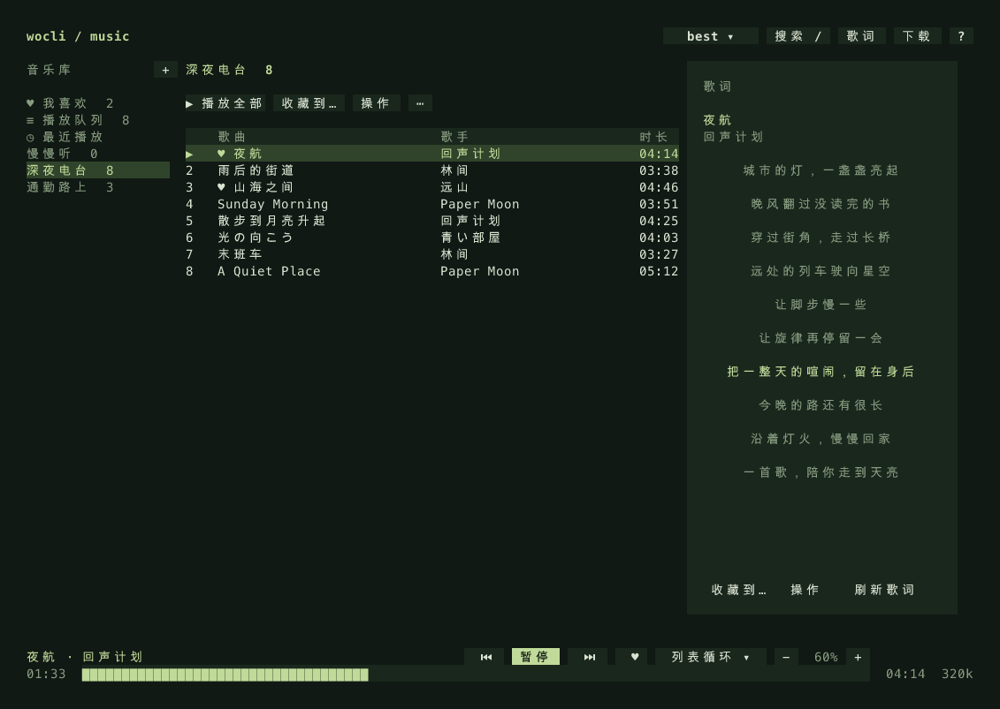
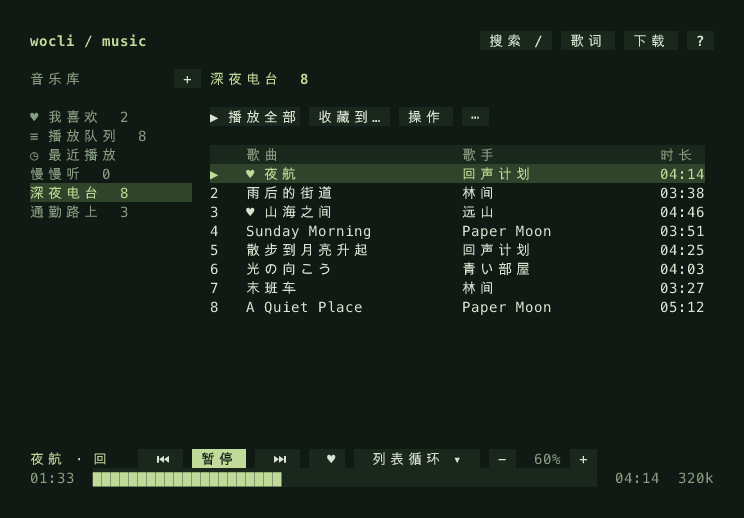

# wocli-music

**Music for your terminal, scripts, and AI workflow.**

A native Rust music player with a keyboard-and-mouse TUI, a scriptable CLI, and a local MCP server. Online search, local audio, lyrics, queues, and playlists share one library. Playback and queued downloads continue after you close the interface.

[中文](README.md) · [Download](https://wocli.yhan.fun/) · [Quick Start](#quick-start) · [Why wocli](#why-wocli-music) · [Comparison](#choosing-a-player) · [Installation](#installation) · [MCP](#local-mcp-server) · [CLI](#cli-usage) · [Keybindings](#keybindings) · [Changelog](CHANGELOG.md)



## Quick Start

macOS / Linux:

```bash
curl -fsSL https://wocli.yhan.fun/install.sh | bash
```

Windows PowerShell:

```powershell
irm https://wocli.yhan.fun/install.ps1 | iex
```

Release packages require no Rust, Python, Node.js, mpv, or FFmpeg installation.

```bash
wocli                          # Open the TUI; / searches, Enter plays
wocli search '周杰伦'            # Inspect candidates first
wocli play '周杰伦' --pick 1     # Explicitly select the first search result
wocli status --json             # Read playback state from a script
wocli mcp config                # Generate an AI client configuration
```

Press `q` to close the TUI while music continues. `wocli stop` stops playback; `wocli daemon stop` stops the background service. Use `?` for keyboard shortcuts or `wocli thelp` for command help.

## Why wocli-music

| Capability | What it helps you do |
| --- | --- |
| **One library across TUI, CLI, and MCP** | Browse in the terminal, pause from a script, and manage a playlist through an AI client without switching player state. MCP provides 17 tools; read-only mode exposes 8 query tools. |
| **Background playback and downloads** | Close the interface and keep listening. Reopen it or issue commands from another terminal to regain control. |
| **Native audio and compact packages** | Audio decoding, playback, and the supported LX script engine ship with the application. v0.3.5 compressed packages are approximately **3.0–4.2 MB**. |
| **Online and local music together** | Search public sources without signing in, and manage online tracks and local MP3, FLAC, AAC/M4A, and WAV files with the same queue, favorites, playlists, and history. Display synchronized LRC lyrics. |
| **Source fallback** | Built-in Kuwo native and mobile endpoints, configurable priorities, and custom sources. Resolution, transfer, or decoding failures try another enabled source; unavailable tracks are skipped. |
| **A separate distribution endpoint** | Installers, release metadata, archives, and source bundles are served through `wocli.yhan.fun`. Native updates use it by default starting with v0.3.5 and retain SHA256 verification. |

Package sizes come from the [v0.3.5 release](https://github.com/yhan-sun/wocli-music/releases/tag/v0.3.5), use decimal MB, and include bundled platform files. They are not memory measurements. Linux ships an ALSA library; keep its `lib/` directory beside the executable.

Useful for terminal and tmux listening, shell shortcuts and status bars, local MCP clients, and a personal library combining online tracks with local files.

## Choosing a Player

| Project | Documented focus | When to consider it |
| --- | --- | --- |
| **wocli-music** | Rust TUI, standalone CLI, and built-in local MCP; shared background service; online/local playback and source fallback | You want terminal control, scripts, and AI integration without relying on platform account synchronization. |
| [Spotify](https://support.spotify.com/us/article/listen-offline/) | Platform catalog and account services; Premium supports offline album and playlist downloads | You want that account and subscription workflow. wocli does not synchronize with a Spotify account. |
| [go-musicfox](https://github.com/go-musicfox/go-musicfox) | A Go terminal client for NetEase Cloud Music, including Last.fm, MPRIS, macOS integration, and DLNA | You prefer the NetEase ecosystem in a terminal or need these integrations. |
| [LX Music Desktop](https://github.com/lyswhut/lx-music-desktop) | Electron/Vue desktop UI, custom sources, a data-sync service, and a local HTTP API | You prefer its graphical workflow, source ecosystem, or synchronization options. Its API also supports integrations. |
| [YesPlayMusic](https://github.com/qier222/YesPlayMusic) | A graphical NetEase client with account login, music videos, personal FM, and recommendations | You value visual browsing and those account-oriented features. |
| [ncmpcpp](https://github.com/ncmpcpp/ncmpcpp) + [MPD](https://www.musicpd.org/) | A terminal client plus a separate music service, with library browsing, tag editing, visualization, and protocol-based control | You already use MPD or want its service and client ecosystem. |

Checked against official documentation on **2026-10-22**. This compares documented workflows, not unmeasured CPU, memory, or startup performance. See the [comparison notes and sources](docs/comparison.md) (Chinese).

### Current Scope

- Search uses the Kuwo catalog. LX compatibility currently covers **`kw/musicUrl`** and supported runtime APIs, rather than the full LX protocol or cross-platform catalog search.
- No platform account login, cloud playlist synchronization, cover-art wall, music videos, personal FM, or system media-key integration.
- MCP is local stdio only. Audio plays on the machine running the daemon; closing MCP leaves that daemon running.
- Search results may lack playable full-length audio. Track availability, quality, startup delay, and access to the Cloudflare endpoint depend on upstream services and network conditions.

## Installation

### Supported Release Packages

| Platform | v0.3.6 archive | Installation note |
| --- | --- | --- |
| macOS 15+, Apple Silicon | `wocli-music-0.3.6-macos-arm64.tar.gz` | Copy `wocli` to a directory on PATH. |
| macOS 15+, Intel | `wocli-music-0.3.6-macos-x86_64.tar.gz` | Copy `wocli` to a directory on PATH. |
| Linux x86_64, glibc 2.35+ | `wocli-music-0.3.6-linux-x86_64.tar.gz` | Keep bundled `lib/` beside `wocli`; uses the system audio configuration. |
| Windows 10/11 x86_64 | `wocli-music-0.3.6-windows-x86_64.zip` | Add the extracted directory to PATH. ARM64 Windows requires x64 emulation support. |

Get archives from the [Cloudflare download page](https://wocli.yhan.fun/) or [GitHub Releases](https://github.com/yhan-sun/wocli-music/releases/latest). The installer verifies SHA256. Matching `*-sources` archives contain dependency sources and are optional for running the player.

### Installer Options

macOS / Linux:

```bash
# Use a directory writable by your account
curl -fsSL https://wocli.yhan.fun/install.sh | bash -s -- --dir /usr/local/bin
# Choose a stable version
curl -fsSL https://wocli.yhan.fun/install.sh | bash -s -- --version v0.3.6
# Uninstall; library data is retained
curl -fsSL https://wocli.yhan.fun/install.sh | bash -s -- --uninstall
```

Windows PowerShell:

```powershell
# Custom installation directory
& ([scriptblock]::Create((irm https://wocli.yhan.fun/install.ps1))) -InstallDir "C:\Tools\wocli"
# Uninstall; library data is retained
& ([scriptblock]::Create((irm https://wocli.yhan.fun/install.ps1))) -Uninstall
```

The Windows installer updates both the user PATH and the current PowerShell session. Other open terminals must fully restart their terminal application. For a stale session from an older default installation:

```powershell
$env:Path += ";$env:LOCALAPPDATA\Programs\wocli-music"
wocli --version
```

Replace that path if you used a custom installation directory.

### Updating

```bash
wocli update --check   # Check the latest stable release
wocli update           # Download, verify SHA256, and update
wocli update --force   # Reinstall the current stable release
```

The command exists from v0.3.1; **Cloudflare becomes the default endpoint in v0.3.5**. If v0.3.1–v0.3.4 cannot reach GitHub, rerun the installer first. Versions v0.3.0 and earlier also need the installer for their first upgrade. Keep the same data directory to preserve your library and settings.

Supports `--json` and `--direct`; the latter bypasses environment proxies while retaining the selected distribution endpoint. Set `WOCLI_DOWNLOAD_BASE=github` to access GitHub directly. Release metadata is cached for up to 10 minutes. See [distribution configuration](docs/distribution.md).

The installation directory must be writable. Updates preserve library data, favorites, queues, and settings. Running daemon/tray processes are restarted; start playback again afterward. Linux launcher wrappers are preserved while the actual binary and bundled ALSA library are updated.

## Local MCP Server

```bash
wocli mcp prompt                # Print a setup prompt to copy to your AI client
wocli mcp config                # Generate client JSON with the executable's absolute path
wocli mcp serve                 # Local stdio server, launched by the client
wocli mcp serve --read-only     # Expose only query tools
wocli mcp tools                 # Inspect tool names and JSON Schemas
```

Running `wocli mcp serve` in a terminal shows a startup confirmation and a prompt to copy to your AI. The prompt includes this machine's executable and library paths, asks the AI to configure a local stdio MCP connection, and verifies it with a status query. `wocli mcp prompt` prints the prompt and exits. The AI client launches its own service process; press `Ctrl+C` to close the manual terminal session. A regular web chat cannot directly connect to a local stdio service.

Clients supporting local stdio MCP can search, control playback, manage queues and playlists, access lyrics, submit downloads, and manage existing source preferences. All 17 tools share the CLI/TUI daemon and library; read-only mode exposes 8 query tools.

Use the generated absolute executable path, especially for graphical clients whose PATH differs from the terminal. `mcp config` prints JSON and does not edit client configuration files. Use `--home` to select a library. See [MCP setup and tool reference](docs/mcp.md).

## CLI Usage

### Help and Sources

```bash
wocli help
wocli thelp download
wocli play --help
wocli help keys
wocli source list
wocli source add ./source.js
wocli source test kuwo-mobile --id 228908 --quality 128k
wocli retry
```

Default sources access Kuwo's native and mobile endpoints directly. Scripts are downloaded only when explicitly imported, then stored locally. Playback does not fetch scripts from GitHub. Enable, disable, or prioritize sources with `source enable ID`, `source disable ID`, and `source prefer ID`.

Embedded QuickJS supports the implemented LX HTTP, promises, timers, basic buffer, MD5, and zlib APIs. AES/RSA, multipart form data, Node modules, and other platforms' song IDs are not supported. HTTP JSON templates are also supported. See [source configuration](docs/sources.md).

### Playback, Library, and Downloads

```bash
wocli play ~/Music/song.flac
wocli pause
wocli resume
wocli toggle
wocli next
wocli prev
wocli seek +15
wocli volume 65
wocli mode shuffle                     # list / repeat / single / shuffle
wocli status --json
wocli like
wocli favorites
wocli playlist create 'Workout'
wocli playlist add 'Workout' --id 61631119
wocli playlist play 'Workout'
wocli queue add --id 61631119 --next
wocli lyrics --id 61631119 --refresh --output song.lrc
wocli download --id 61631119 --quality 320k --lyrics --output ~/Music
wocli stop
wocli daemon status
wocli daemon stop
```

Use `--pick` or an exact `--id` when selecting an online track in a script. `play --no-wait` returns after loading is queued. `download --force` replaces an existing file only after a successful transfer and validation.

In the TUI, press `d` to open the download form and `D` to view tasks. Submission errors stay in the form. Failed tasks can be retried; active tasks can be cancelled. Closing the TUI leaves tasks running; stopping the daemon cancels unfinished tasks. Existing files are preserved when validation fails.

### Tray and Lyrics

```bash
wocli tray start
wocli tray status
wocli tray stop
wocli lyrics-bar on
wocli lyrics-bar off
wocli lyrics-bar toggle
```

macOS provides a menu-bar item with lyrics and playback controls. Windows provides a notification-area tray and taskbar lyrics with previous/play-pause/next buttons and a draggable text area. Linux currently uses the TUI/CLI without tray support.

## Keybindings

| Key | Action |
| --- | --- |
| `j` / `k` or `↓` / `↑` | Move down / up |
| `g` / `G` or `Home` / `End` | First / last item |
| `[` / `]` or `<` / `>` or Media Keys | Previous / next track |
| `Space` or Play/Pause Media Key | Play / pause (starts playback if idle/stopped) |
| `Enter` | Play selection / confirm |
| `/` or `Ctrl+F` | Search |
| `←` / `→` | Seek backward / forward 5 seconds |
| `+` / `-` or Volume Media Keys | Adjust volume |
| `Ctrl+U` / `Ctrl+D` | Page up / down |
| `v` | Toggle full-screen lyrics |
| `m` | Cycle playback mode |
| `c` / `f` | Add to playlist / toggle favorite |
| `d` / `D` | Download selection / view download tasks |
| `a` / `x` | Add to queue / open track menu |
| `Tab` / `b` | Switch focus / choose library |
| `?` / `Esc` | Shortcut help / close current view or popup |
| `q` | Close TUI; playback continues |

> **Global System Shortcuts & Media Keys**:
> - When the tray is running in the background, macOS natively integrates with `MPRemoteCommandCenter` and Control Center (Now Playing), and Windows natively registers global media hotkeys; physical hardware media keys (Play/Pause, Previous, Next, Volume) work globally.
> - Inside the terminal TUI, keyboard hardware media keys directly control playback, track switching, and volume anywhere in the interface.
> - System shortcut tools (macOS Shortcuts, Raycast, Alfred, Windows shortcuts, Linux hotkeys) can seamlessly trigger `wocli toggle`, `wocli prev`, `wocli next`, automatically waking and playing when idle or stopped.



## Environment Variables and Configuration

| Variable | Default | Purpose |
| --- | --- | --- |
| `WOCLI_HOME` | `~/.config/wocli-music` on Linux/macOS; `%APPDATA%\wocli-music` on Windows | Library, settings, lyrics cache, and daemon log. |
| `WOCLI_RUNTIME_DIR` | An account/data-directory-specific runtime path | IPC socket or endpoint; inspect its resolved path with `wocli doctor`. |
| `WOCLI_DOWNLOAD_BASE` | `https://wocli.yhan.fun` | Installer/updater endpoint; `github` selects direct GitHub access. |
| `WOCLI_DOWNLOAD_DIR` | `~/Music/wocli` in TUI; `downloads` in CLI | Song and lyric download directory. |
| `WOCLI_AUDIO_OUTPUT` | System audio output | `null` decodes silently for tests or headless environments. |
| `HTTP_PROXY` / `HTTPS_PROXY` | Unset | Environment proxy settings for network requests. |

```bash
wocli config
wocli config quality best
wocli config mode repeat
wocli config volume 70
wocli config lyric_offset 200
wocli config direct true
wocli doctor
```

Use the same `WOCLI_HOME` when upgrading or switching entry points. To back up the library, stop the daemon and copy the whole data directory; back up downloaded music separately.

## Troubleshooting

**A search result will not play.** The upstream catalog may lack a full-length audio URL or the selected quality. The player retries and falls back across enabled sources while keeping the same Kuwo track ID. Unavailable tracks are skipped; if the entire queue fails, playback stops with an error.

**No sound.** Check `wocli status`, volume, and the system audio output. `WOCLI_AUDIO_OUTPUT=null` intentionally produces no sound. An audio-device failure is reported directly rather than skipping the whole queue.

**Lyrics are missing or mismatched.** Refresh them independently or place a matching `.lrc` beside a local audio file. Live/remix recordings may need different lyrics.

**Can SSH or MCP forward remote audio?** Control commands act on the daemon's machine, which also produces the sound. The player does not forward audio to the client machine.

## Building and Verification

Requires Rust **1.93.1+** and a C compiler. Use Xcode Command Line Tools on macOS, MSVC on Windows, or `libasound2-dev` and `pkg-config` on Linux.

```bash
git clone https://github.com/yhan-sun/wocli-music.git
cd wocli-music
cargo build --release --locked
cargo test --locked --all-targets
cargo clippy --locked --all-targets -- -D warnings
```

GitHub Actions builds Windows x86_64, macOS ARM64/Intel, and Linux x86_64 packages and verifies the extracted programs before publishing. Checks cover playback, MCP, executable replacement, Windows installation/PATH behavior, and a clean Linux container. Python is used for development packaging and screenshots, not at player runtime.

README screenshots are rendered from the Rust TUI using an isolated fictional library. They illustrate the interface rather than live music availability.

## Credits and Third-Party Components

Terminal interaction was inspired by [MiaowCham/ncm-cli](https://github.com/MiaowCham/ncm-cli). The player uses Ratatui, Rodio/Symphonia, SQLite, QuickJS, the official Rust MCP SDK, and other components.

Third-party notices ship in each archive's `THIRD_PARTY.txt` and `licenses/`. Matching `*-sources` archives provide the required dependency sources and are optional for running the application.
