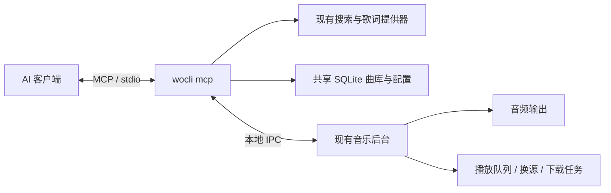

# MCP 服务

播放器通过本地 MCP 服务向 AI 客户端开放搜索、播放、收藏和下载等能力。实现使用 [官方 Rust SDK](https://github.com/modelcontextprotocol/rust-sdk)，客户端与服务以标准输入/输出通信，不需要 HTTP 端口、Python 或 Node.js。

## 架构



MCP 是现有播放器的入口，和 CLI、TUI 共用曲库、收藏、设置及后台进程。启动 MCP 不启动音频后台；首次播放、修改队列或下载时按需启动。查询状态不启动后台。关闭 MCP 后，已经开始的音乐和下载继续运行。

## 启动与配置

```bash
wocli mcp
# 等价于
wocli mcp serve

# 仅开放查询工具
wocli mcp serve --read-only

# 输出接入提示词后退出，复制给 AI 帮你配置并验证连接
wocli mcp prompt
wocli mcp prompt --read-only
# 自动化使用：输出包含 prompt 和 config 的 JSON
wocli mcp prompt --json

# 输出客户端接入配置
wocli mcp config
wocli mcp config --read-only --home /absolute/path/to/data

# 不启动 MCP 会话，查看工具名称及参数 JSON Schema
wocli mcp tools
wocli help mcp
```

直接在终端运行 `serve` 会显示“启动成功，正在等待 AI 客户端连接”和“复制下面的提示词给 AI”，后面附上完整提示词及本机配置。这表示服务就绪，尚未完成 AI 客户端连接；等待协议消息是正常行为。可按 `Ctrl+C` 退出等待，也可用 `wocli mcp prompt` 单独获取提示词后退出。

复制提示词给支持本地 stdio MCP 的 AI 客户端。提示词要求 AI 核对客户端配置格式、保留已有服务、加入本机配置、重新加载连接，然后列出工具并调用 `get_playback_status` 验证，不会要求自动播放或下载。无配置权限时，AI 应指导你完成设置；普通网页聊天无法直接访问本机服务。

`serve` 实际由 MCP 客户端作为独立子进程启动，不连接终端中手动运行的那个进程。终端启动提示只写入 stderr；客户端使用管道启动时保持安静，stdout 始终只包含 MCP 报文。

在使用 `mcpServers` 格式的客户端配置中加入 `wocli mcp config` 的输出。例如：

```json
{
  "mcpServers": {
    "wocli-music": {
      "command": "/absolute/path/to/wocli",
      "args": ["mcp", "serve"]
    }
  }
}
```

建议使用程序绝对路径，尤其是 Windows 或图形界面客户端的 PATH 与终端不同的情况。以本机 mcp config 的实际输出为准，无需手动猜测 Windows 安装位置。此命令不修改客户端配置文件。

`--home` / `WOCLI_HOME` 可选定不同曲库；`--direct` 忽略环境代理。`mcp config` 和 `mcp prompt` 会将当前程序的绝对路径、数据目录及只读/直连选项写入输出，避免客户端连接到其他曲库。

如果当前安装包还没有 `mcp` 命令，可从此工作目录构建：

```bash
cargo build --release --locked
./target/release/wocli mcp config
# Windows: .\target\release\wocli.exe mcp config
```

## 工具

| 工具 | 参数与行为 | 只读模式 |
| --- | --- | --- |
| `search_music` | `keyword`，可选 `page`、`limit`；返回候选歌曲 ID | 开放 |
| `get_playback_status` | 当前歌曲、阶段、进度、音量、模式、音源及错误摘要 | 开放 |
| `get_queue` | `offset`、`limit`；队列分页和当前序号 | 开放 |
| `get_library` | `kind`: `favorites/history/playlists/playlist`；单个歌单需 `name`；支持分页 | 开放 |
| `get_daily_recommendations` | 查看当天快照和推荐理由；未生成时 `daily` 为 null，不触发生成 | 开放 |
| `manage_daily_recommendations` | `action`: `refresh`（可选 `offline`）、`play`、`add`、`set_excluded`（需 `track_id`、`excluded`） | 不开放 |
| `get_lyrics` | 可选 `track_id`、`refresh`；缺少 ID 时使用当前歌曲 | 开放 |
| `get_downloads` | `offset`、`limit`；下载任务按最新在前分页 | 开放 |
| `list_music_sources` | 音源 ID、类型、顺序、启用状态及音质；不返回脚本或接口 URL | 开放 |
| `get_player_config` | 持久化偏好 | 开放 |
| `play_music` | `track_id` 或本地 `path`，可选 `quality`；二者都省略则重新播放当前队列项 | 不开放 |
| `control_playback` | `action`: `pause/resume/toggle/stop/next/previous/retry/seek/volume/mode` | 不开放 |
| `manage_queue` | `action`: `add/remove/clear`；添加需 `track_ids`，移除需 `index` 和匹配的 `track_id` | 不开放 |
| `manage_playlist` | `action`: `create/rename/delete/add/remove/play`；需 `name` 及相应字段 | 不开放 |
| `set_favorite` | `liked` 指定目标状态，可选 `track_id`；重复调用不会切换 | 不开放 |
| `download_music` | `track_id`，可选 `directory/quality/lyrics/overwrite`；返回 `job_id` | 不开放 |
| `manage_download` | `action`: `cancel/retry`，需 `job_id` | 不开放 |
| `configure_player` | `key`、`value`；支持现有音质、音量、模式、代理、歌词、托盘偏好 | 不开放 |
| `manage_music_sources` | `action`: `enable/disable/prefer`，需已有 `source_id` | 不开放 |

`mcp tools` 输出完整参数 Schema。参数有类型、范围和未知字段检查；例如音量只能是 0–100，分页 `limit` 是 1–100，`offset` 从 0 开始。队列 `index` 和返回的 `current_index` / `queue_index` **从 1 开始**，空队列时当前序号为 `null`。

`control_playback` 的特定参数为：

```json
{"action":"seek","seconds":-10}
{"action":"volume","value":50}
{"action":"mode","value":"shuffle"}
{"action":"retry","quality":"128k"}
```

`configure_player` 示例：

```json
{"key":"quality","value":"320k"}
{"key":"lyric_offset","value":500}
{"key":"lyrics_bar","value":true}
```

`manage_playlist` 的重命名使用 `new_name`，添加或移除歌曲使用 `track_id`。`manage_queue` 的 `add` 最多接受 100 个 ID，`next: true` 表示加到当前歌曲后面。

模型应先搜索并根据用户意图选择明确的 ID；结果有歧义时，不默认播放第一首。`play_music` 不接受原始搜索关键词或任意 IPC 操作。

## 异步播放和下载

播放/切歌/重试返回当前状态，通常是 `phase: "loading"`。这表示后台接受操作，并不代表音频已经可播放，应继续查询 `get_playback_status`，直到 `playing`、`paused` 或 `error`。MCP 关闭不会停止后台；停止播放应调用 `control_playback` 的 `stop`。

`download_music` 返回 `job_id` 及任务快照，随后用 `get_downloads` 查看 `queued/resolving/downloading/lyrics/done/error/cancelled` 等阶段。`done` 才表示文件保存成功。取消下载用 `manage_download`，取消一个 MCP 请求本身不等价于取消后台下载。

音频仍由已有后台处理，使用同一套换源、完整性检查和解码校验。默认不覆盖已有文件；需要覆盖时显式传入 `overwrite: true`。

## 只读资源

所有模式下均提供以下 JSON 快照：

- `wocli://status`
- `wocli://queue`（第一页 20 首）
- `wocli://sources`
- `wocli://settings`
- `wocli://downloads`（最新 20 项）

完整分页列表使用工具读取。资源不接受任意 `file://` 路径，不提供订阅通知；客户端按需重新读取。

## 协议与边界

支持旧式 `initialize` 握手的 `2024-11-05`、`2025-03-26`、`2025-06-18`、`2025-11-25`，以及 `2026-07-28` 的 `server/discover` / 每请求元数据机制；版本协商和 JSON-RPC 由官方 SDK 处理。

工具同时提供文本 JSON 与 `structuredContent`；业务或参数错误使用 `isError: true`，包含可用于修正调用的错误码和说明。未知方法、未知工具和不存在的资源使用协议错误。

最多并发 8 个后台工具/资源操作；等待上限 45 秒，输入每行最大 64 KiB，单次数据结果最大 512 KiB。取消通知会结束等待，并阻止尚未进入下一阶段的工作；已提交的播放、下载及写入不能自动回滚。需要停止这些操作时，应显式使用对应控制工具。

只读模式隐藏写工具，同时在执行层再次检查，不允许通过直接发送工具名绕过。只读模式仍可搜索和联网获取歌词，但不写入新的歌曲/歌词缓存、收藏、歌单、偏好或音源设置。

初版只提供本地 stdio，不开放网络 MCP 接口。更新程序、停止后台进程、导入/执行新音源脚本和任意系统命令均不作为 MCP 工具暴露。这些操作继续通过现有 CLI 完成。
